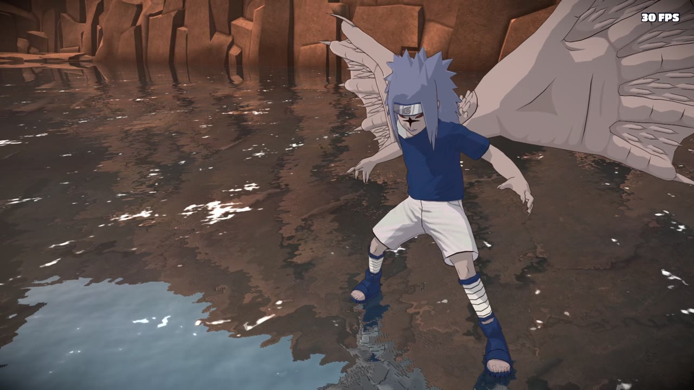
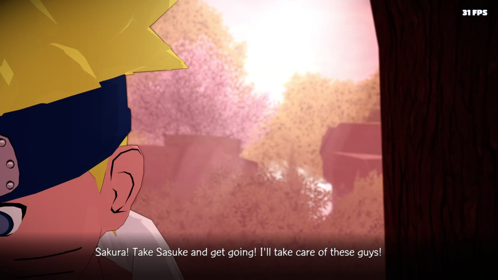
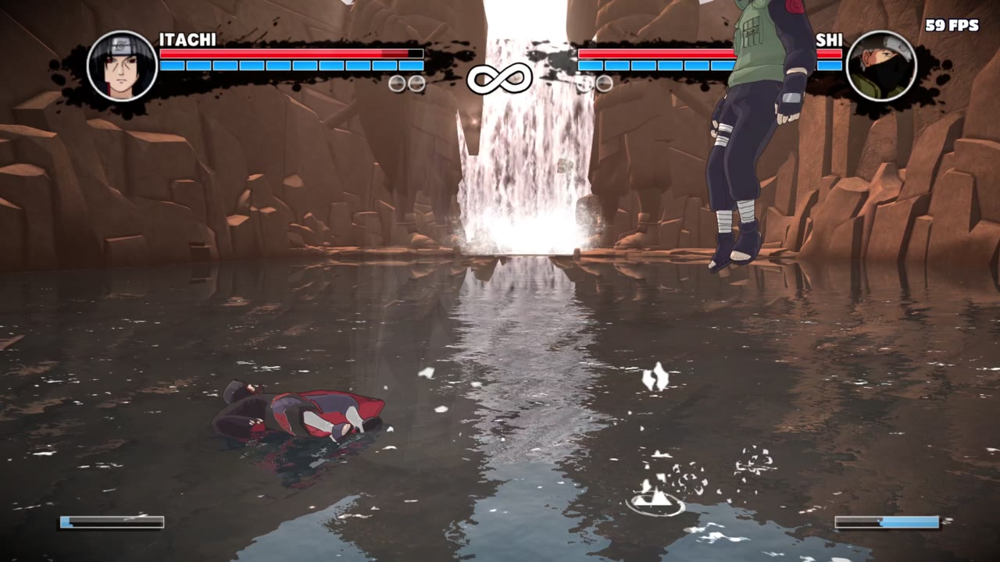
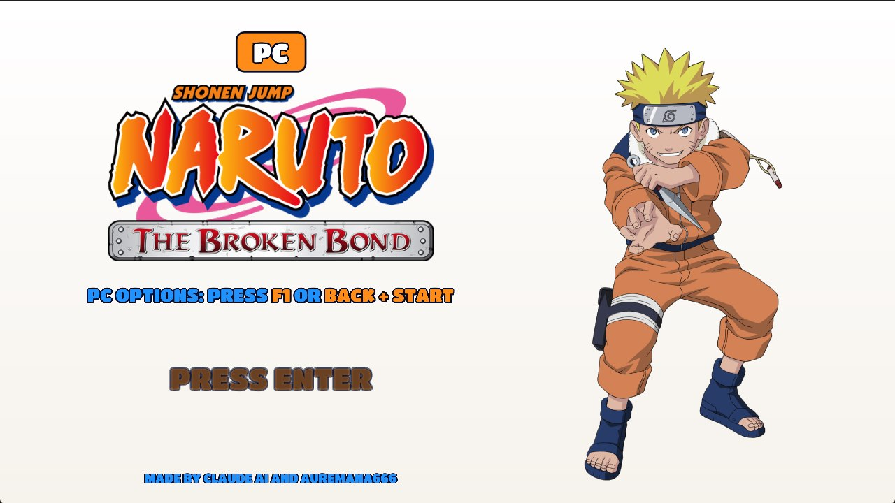
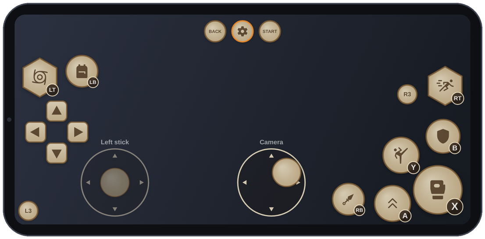

# Naruto: The Broken Bond — Android Port

**The Xbox 360 game, recompiled to run natively on Android phones.** 
Unofficial fan port · bring your own game

### [⬇ Download the APK](../../releases)

[Install](#install) · [Requirements](#requirements) · [Controls](#controls) · [FAQ](#faq) · [Build it yourself](docs/android.md)

Screenshots from the PC version: the Android port runs the same game and renderer.

> [!IMPORTANT]
> **No game files are included.** You need your own copy of the game as an Xbox 360 disc image
> (ISO). This project is not affiliated with or endorsed by Ubisoft, Bandai Namco, Shueisha, Viz
> Media or Microsoft. Naruto is a trademark of its owners.

> [!WARNING]
> **Alpha:** these are the first builds to run on phones. Expect crashes and graphics problems, and
> please [report them](#reporting-problems): logs from real phones are what move the port forward.

## What it is

The Android version of the [Naruto: The Broken Bond PC Port v2.5](docs/pc-port.md). The game's
Xbox 360 code is recompiled ahead of time with the [ReXGlue SDK](https://github.com/rexglue/rexglue-sdk),
so it runs natively instead of being emulated, and its graphics go through a native **Vulkan**
renderer.

<table>
<tr>
<td width="33%"></td>
<td width="33%"></td>
<td width="33%"></td>
</tr>
</table>

<table>
<tr>
<td width="50%">

**🎮 The full game** 
The recompiled game with the PC port's native renderer and its **PC Options** menu.

</td>
<td width="50%">

**📱 A launcher** 
Pick your ISO once, adjust the settings for your phone, and tap **Play**.

</td>
</tr>
<tr>
<td>

**🕹️ Touch or controller** 
On-screen controls with floating sticks, or any Bluetooth / USB controller.

</td>
<td>

**💾 Your saves stay** 
New versions install over the old one and keep your saves and settings.

</td>
</tr>
</table>

## Install

1. Download the **APK** from [Releases](../../releases) and open it on your phone (allow installing
   apps from your browser or file manager when Android asks).
2. Open **Naruto: The Broken Bond** and tap **Choose game ISO…** to pick your ISO. Nothing is
   copied: the game reads the ISO where it is.
3. Check **Settings** (resolution, frame rate, on-screen controls), then tap **Play**. The first
   start takes a while.

You can also copy the ISO into `Android/data/org.brokenbond.port/files/assets/`, where the game
finds it on its own.

## Requirements

| | |
|---|---|
| **Android** | 10 or newer, 64-bit (arm64) |
| **GPU** | **Snapdragon** phone (Adreno 6xx or newer) with Vulkan 1.1 |
| **Memory** | 6 GB of RAM or more recommended |
| **Storage** | Your ISO (about 7 GB) plus about 1 GB |
| **Game** | Your own Xbox 360 ISO of Naruto: The Broken Bond |

Phones with **Mali** (Exynos, most MediaTek) or **PowerVR** GPUs are not supported yet: the game's
textures need a format their Vulkan drivers lack.

## Controls

| | |
|---|---|
| **Buttons** | Each shows its action: **X** attack (the big one), **Y** heavy attack, **A** jump, **B** block, **RB** kunai, **RT** sprint, **LT** jutsus, **LB** inventory; the small badge names the pad button |
| **Sticks** | Touch the lower left to move and the lower middle to turn the camera; each stick appears where your thumb lands |
| **Gear button** | Opens **PC Options** (Back + Start), with every graphics and game option |
| **Controllers** | Bluetooth and USB controllers and the built-in controls of handhelds like the Retroid Pocket work (Xbox, PlayStation, Switch Pro and most Android gamepads) and are player 1; the on-screen controls hide while one is connected; **Back + Start** opens PC Options |
| **Back gesture** | Opens a menu to continue, hide or show the on-screen controls, or quit |

The opacity and size of the on-screen controls are in the launcher's **Settings**.

## FAQ

<b>Why do I need my own ISO?</b>

The app has the game's code, converted for phones, but none of its graphics, sounds, music or
levels. Those come from your ISO, the same way the PC version works.

<b>Will it run on my phone?</b>

If it has a Snapdragon chip with an Adreno 6xx or newer GPU and Android 10+, it should start; how
well it runs depends on the phone. When the phone's own Qualcomm driver lacks a feature the
renderer needs (as on the Snapdragon 865), the app switches to **Turnip**, the open-source Adreno
driver it carries (Settings > GPU driver). Mali and PowerVR GPUs are not supported yet.

<b>Where are my saves?</b>

In `Android/data/org.brokenbond.port/files/`: `hdd/` (saves), `naruto.toml` (settings) and
`logs/`. New versions keep them, but **uninstalling the app deletes this folder**: back up `hdd/`
first.

<b>It runs slowly or gets hot.</b>

Lower the render resolution in **Settings**, keep the frame rate at 30 FPS, and leave
anti-aliasing off. The first time an area is played it can stutter while its graphics are
prepared; they are kept for the next sessions. To report slowness, turn on **Settings >
Performance log**, play the slow part, and send the zip of **Save logs for a problem report**.

<b>How is the APK made?</b>

It is built from the game's executable once, like the PC version's `.exe`: on Windows with
`scripts/build-android.ps1`, or in the cloud with this repository's **Android APK** workflow. See
[docs/android.md](docs/android.md).

## Reporting problems

In the launcher, tap **Save logs for a problem report**: it saves a zip with the game's logs and
your device's details in **Downloads**. [Open an issue](../../issues) with that zip and a few words
about what happened.

**Known limitations:** Adreno only; switching away from the app and back is the least tested
path, so quitting from the back menu is the safest way out; frame rates above 30 FPS depend
heavily on the phone and its temperature.

## Build it yourself

Everything about building the APK, from your PC or in the cloud, signing, and how the port works:
**[docs/android.md](docs/android.md)**. The PC version's own guide is
[docs/pc-port.md](docs/pc-port.md).

## Credits

| Part | Made by |
|---|---|
| Android port: ReXGlue SDK patch for Android, Vulkan on Android, launcher app, on-screen controller | this repository, written with Claude AI |
| PC port v2.5: PC Options, remapping, Auto Jutsu, free camera, weather, Hokage skins and more | Auremana666 and Claude AI ([details](docs/pc-port.md#who-made-what)) |
| Recompilation setup, XMA audio fixes and the native renderer | [jorjbarbosa](https://github.com/jorjbarbosa) ([broken-bond-recomp](https://github.com/jorjbarbosa/broken-bond-recomp)) |
| Static recompilation runtime | [ReXGlue SDK](https://github.com/rexglue/rexglue-sdk) (BSD-3-Clause), built on [Xenia](https://github.com/xenia-project/xenia) |
| Input, audio and the app's game activity | [SDL3](https://libsdl.org) (zlib license) |
| Icons of the on-screen controls | [Material Symbols](https://github.com/google/material-design-icons) (Apache License 2.0) |
| Turnip, the bundled Adreno Vulkan driver | [Mesa](https://mesa3d.org) (MIT), loaded with [libadrenotools](https://github.com/bylaws/libadrenotools) (BSD-2-Clause) |

Thanks to everyone credited in the [PC port](docs/pc-port.md#credits), including **tylerl567**
for testing on the Steam Deck. The style of the on-screen controls is inspired by
[Masterllgod's Naruto: Rise of a Ninja port](https://github.com/Masterllgod/naruto-rise-of-a-ninja-port-nativo).

## License

The code in this repository is released under the [GNU General Public License v3](LICENSE), the
same license as the projects it builds on. It does not cover the game, its code, art, music or
trademarks, which belong to their owners.
